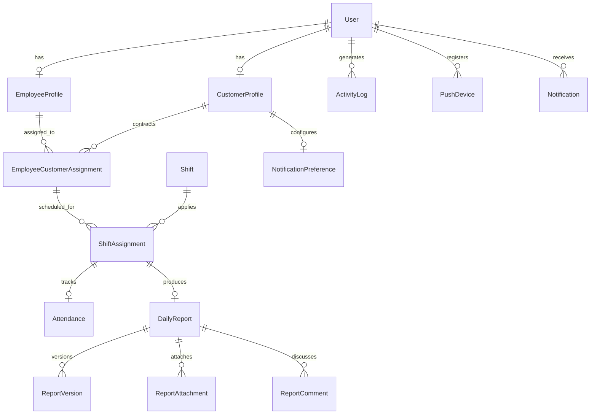

# WorkTrack PostgreSQL Database Architecture & Schema Design

**Database:** PostgreSQL 16+ / 18+  
**ORM:** Django ORM (Django 5.x)  
**Timezone Standard:** Coordinated Universal Time (UTC) for all stored timestamps. Converted to user's localized timezone on frontend render.

---

## 1. Entity Relationship Overview

---

## 2. Table Schemas & Specifications

### 2.1 `accounts_user` (Custom User Model)
*Inherits from Django `AbstractUser` with email-based authentication.*

| Field | Type | Constraints / Attributes | Description |
| :--- | :--- | :--- | :--- |
| `id` | `UUIDField` | Primary Key, `default=uuid.uuid4`, editable=False | Globally unique identifier |
| `email` | `EmailField(255)` | Unique, Not Null, Index | Primary login identifier |
| `username` | `CharField(150)` | Nullable, Blank | Optional fallback username |
| `first_name` | `CharField(150)` | Not Null | User first name |
| `last_name` | `CharField(150)` | Not Null | User last name |
| `role` | `CharField(20)` | Choices: `ADMIN`, `EMPLOYEE`, `CUSTOMER`, Index | User role discriminator |
| `is_active` | `BooleanField` | `default=True`, Index | Soft-deactivation toggle |
| `is_staff` | `BooleanField` | `default=False` | Django admin access |
| `date_joined` | `DateTimeField` | `auto_now_add=True` | Account registration time (UTC) |
| `updated_at` | `DateTimeField` | `auto_now=True` | Last profile update time (UTC) |

**Indexes & Constraints:**
- `UNIQUE INDEX idx_user_email (email)`
- `INDEX idx_user_role_active (role, is_active)`

---

### 2.2 `employees_employeeprofile`
*One-to-One extension for staff members and surveillance operators.*

| Field | Type | Constraints / Attributes | Description |
| :--- | :--- | :--- | :--- |
| `id` | `UUIDField` | Primary Key, `default=uuid.uuid4` | Profile identifier |
| `user` | `OneToOneField(User)` | `on_delete=CASCADE`, related_name='employee_profile' | Associated user account |
| `employee_code` | `CharField(30)` | Unique, Not Null, Index | e.g., `EMP-101`, `EMP-AARAV` |
| `phone` | `CharField(30)` | Blank, Nullable | Contact telephone |
| `designation` | `CharField(100)` | Default='Field Specialist' | e.g. Senior CCTV Operator, Shift Lead |
| `department` | `CharField(100)` | Default='Operations' | e.g. Security, Store Operations |
| `profile_image` | `ImageField` | Upload to `employees/avatars/`, Nullable | Profile avatar image |
| `address` | `TextField` | Blank, Nullable | Physical address |
| `joining_date` | `DateField` | Not Null | Date hired |
| `status` | `CharField(20)` | Choices: `ACTIVE`, `INACTIVE`, `ON_LEAVE`, Default='ACTIVE' | Status indicator |

**Indexes & Constraints:**
- `UNIQUE INDEX idx_employee_code (employee_code)`

---

### 2.3 `customers_customerprofile`
*One-to-One extension for enterprise client stores and businesses.*

| Field | Type | Constraints / Attributes | Description |
| :--- | :--- | :--- | :--- |
| `id` | `UUIDField` | Primary Key, `default=uuid.uuid4` | Profile identifier |
| `user` | `OneToOneField(User)` | `on_delete=CASCADE`, related_name='customer_profile' | Associated user account |
| `customer_code` | `CharField(30)` | Unique, Not Null, Index | e.g., `CUST-104`, `CUST-ACME` |
| `company_name` | `CharField(200)` | Not Null, Index | e.g. Acme Retail Store #104 |
| `industry` | `CharField(100)` | Blank | e.g. Retail Superstore, Logistics |
| `contact_person` | `CharField(150)` | Not Null | Primary business representative |
| `phone` | `CharField(30)` | Blank, Nullable | Contact telephone |
| `address` | `TextField` | Blank, Nullable | Store / Facility location |
| `timezone` | `CharField(50)` | Default='America/Chicago' | Localized store timezone (IANA string) |
| `account_status` | `CharField(20)` | Choices: `ACTIVE`, `SUSPENDED`, `TRIAL`, Default='ACTIVE' | Account state |
| `brand_color` | `CharField(10)` | Default='#245CE2' | UI badge theme accent |

**Indexes & Constraints:**
- `UNIQUE INDEX idx_customer_code (customer_code)`
- `INDEX idx_customer_company (company_name)`

---

### 2.4 `assignments_employeecustomerassignment`
*Contracts linking employees to customer locations.*

| Field | Type | Constraints / Attributes | Description |
| :--- | :--- | :--- | :--- |
| `id` | `UUIDField` | Primary Key, `default=uuid.uuid4` | Assignment ID |
| `employee` | `ForeignKey(EmployeeProfile)` | `on_delete=PROTECT`, related_name='customer_assignments' | Assigned staff member |
| `customer` | `ForeignKey(CustomerProfile)` | `on_delete=PROTECT`, related_name='employee_assignments' | Client account |
| `assigned_by` | `ForeignKey(User)` | `on_delete=PROTECT` | Admin who created assignment |
| `status` | `CharField(20)` | Choices: `PENDING`, `ACTIVE`, `REVOKED`, Default='ACTIVE' | Contract status |
| `notes` | `TextField` | Blank, Nullable | Administrator allocation remarks |
| `created_at` | `DateTimeField` | `auto_now_add=True` | Contract start timestamp |
| `updated_at` | `DateTimeField` | `auto_now=True` | Last status change timestamp |

**Indexes & Constraints:**
- `UNIQUE INDEX idx_active_emp_cust (employee, customer, status)` where status = 'ACTIVE' (ensures no duplicate active contract between same staff and client).
- `INDEX idx_assignment_status (status)`

---

### 2.5 `shifts_shift`
*Master shift definitions and recurring templates.*

| Field | Type | Constraints / Attributes | Description |
| :--- | :--- | :--- | :--- |
| `id` | `UUIDField` | Primary Key, `default=uuid.uuid4` | Shift ID |
| `name` | `CharField(100)` | Not Null | e.g. Morning Shift, Afternoon Shift, Night Shift |
| `start_time` | `TimeField` | Not Null | Shift start (e.g. 06:00:00) |
| `end_time` | `TimeField` | Not Null | Shift end (e.g. 14:00:00) |
| `grace_period_minutes` | `PositiveSmallIntegerField` | Default=15, minimum=0 | Allowed lateness before marking a punch `LATE` |
| `description` | `TextField` | Blank, Nullable | Shift responsibilities & instructions |
| `is_overnight` | `BooleanField` | Default=False | True if shift crosses midnight |
| `is_active` | `BooleanField` | Default=True | Template active flag |
| `color_tag` | `CharField(10)` | Default='#3B82F6' | Calendar color tag |
| `created_at` | `DateTimeField` | `auto_now_add=True` | Timestamp |
| `updated_at` | `DateTimeField` | `auto_now=True` | Timestamp |

---

### 2.6 `shifts_shiftassignment`
*Specific operational shift schedule allocated to an employee for a client on a calendar date.*

| Field | Type | Constraints / Attributes | Description |
| :--- | :--- | :--- | :--- |
| `id` | `UUIDField` | Primary Key, `default=uuid.uuid4` | Schedule ID |
| `employee_customer_assignment` | `ForeignKey(EmployeeCustomerAssignment)` | `on_delete=CASCADE`, related_name='shift_schedules' | Associated contract |
| `shift` | `ForeignKey(Shift)` | `on_delete=PROTECT`, related_name='scheduled_shifts' | Shift template |
| `shift_date` | `DateField` | Not Null, Index | Scheduled calendar date |
| `assigned_by` | `ForeignKey(User)` | `on_delete=PROTECT` | Admin who scheduled shift |
| `status` | `CharField(20)` | Choices: `SCHEDULED`, `IN_PROGRESS`, `COMPLETED`, `CANCELLED`, Default='SCHEDULED' | Shift progression status |
| `created_at` | `DateTimeField` | `auto_now_add=True` | Timestamp |
| `updated_at` | `DateTimeField` | `auto_now=True` | Timestamp |

**Indexes & Constraints:**
- `UNIQUE INDEX idx_emp_shift_date (employee_customer_assignment, shift, shift_date)`
- `INDEX idx_shift_date_status (shift_date, status)`

---

### 2.7 `attendance_attendance`
*Biometric and virtual punch-in/out records.*

| Field | Type | Constraints / Attributes | Description |
| :--- | :--- | :--- | :--- |
| `id` | `UUIDField` | Primary Key, `default=uuid.uuid4` | Attendance ID |
| `shift_assignment` | `OneToOneField(ShiftAssignment)` | `on_delete=CASCADE`, related_name='attendance_record' | Target shift |
| `check_in` | `DateTimeField` | Nullable | Punch-in timestamp (UTC) |
| `check_out` | `DateTimeField` | Nullable | Punch-out timestamp (UTC) |
| `attendance_status` | `CharField(20)` | Choices: `PRESENT`, `ABSENT`, `LATE`, `INCOMPLETE` (legacy `HALF_DAY`, `OVERTIME`) | Attendance adherence status |
| `duration_hours` | `DecimalField(5,2)` | Default=0.00 | Computed shift duration |
| `notes` | `TextField` | Blank, Nullable | Employee punch remarks |
| `location_verified` | `BooleanField` | Default=True | IP/Geo check confirmation |
| `created_at` | `DateTimeField` | `auto_now_add=True` | Timestamp |
| `updated_at` | `DateTimeField` | `auto_now=True` | Timestamp |

**Check Constraints:**
- `CHECK (check_out IS NULL OR check_out >= check_in)` (Check-out cannot precede check-in).
- `CHECK (duration_hours >= 0)`.
- Index on `(attendance_status, check_in)` for status and punch queries.

---

### 2.8 `reports_dailyreport`
*Primary daily operational handover logs.*

| Field | Type | Constraints / Attributes | Description |
| :--- | :--- | :--- | :--- |
| `id` | `UUIDField` | Primary Key, `default=uuid.uuid4` | Report ID |
| `shift_assignment` | `OneToOneField(ShiftAssignment)` | `on_delete=CASCADE`, related_name='daily_report' | Associated shift |
| `title` | `CharField(255)` | Not Null | Summary title of report |
| `work_summary` | `TextField` | Not Null | Overview of shift operations |
| `tasks_completed` | `TextField` | Blank, Nullable | Detailed breakdown of completed items |
| `pending_tasks` | `TextField` | Blank, Nullable | Handover tasks for following shift |
| `issues_or_blockers` | `TextField` | Blank, Nullable | Obstacles, security anomalies |
| `additional_remarks` | `TextField` | Blank, Nullable | General staff notes |
| `version` | `IntegerField` | Default=1 | Monotonically increasing revision count |
| `status` | `CharField(20)` | Choices: `DRAFT`, `SUBMITTED`, Default='DRAFT' | Report state |
| `submitted_at` | `DateTimeField` | Nullable | First submission timestamp (UTC) |
| `last_updated_at` | `DateTimeField` | Nullable | Most recent edit timestamp (UTC) |
| `created_by` | `ForeignKey(User)` | `on_delete=PROTECT`, related_name='authored_reports' | Report author |
| `updated_by` | `ForeignKey(User)` | `on_delete=PROTECT`, related_name='updated_reports' | Last modifying user |

---

### 2.9 `reports_reportversion`
*Immutable historical snapshots for every report edit.*

| Field | Type | Constraints / Attributes | Description |
| :--- | :--- | :--- | :--- |
| `id` | `UUIDField` | Primary Key, `default=uuid.uuid4` | Version record ID |
| `daily_report` | `ForeignKey(DailyReport)` | `on_delete=CASCADE`, related_name='versions' | Parent report |
| `version_number` | `IntegerField` | Not Null | Version sequence (1, 2, 3...) |
| `title_snapshot` | `CharField(255)` | Not Null | Title at this version |
| `content_snapshot` | `JSONField` | Not Null | Complete JSON payload of all text fields |
| `previous_content_snapshot` | `JSONField` | Nullable | Content before the corresponding edit |
| `modified_by` | `ForeignKey(User)` | `on_delete=PROTECT` | User who made this revision |
| `modified_at` | `DateTimeField` | `auto_now_add=True` | Timestamp of this revision |
| `change_summary` | `TextField` | Blank | Author's notes on why revision was made |

**Indexes & Constraints:**
- `UNIQUE INDEX idx_report_version (daily_report, version_number)`
- Index on `(daily_report, modified_at)` for history retrieval

---

### 2.10 `reports_reportattachment`
*File uploads associated with daily reports.*

| Field | Type | Constraints / Attributes | Description |
| :--- | :--- | :--- | :--- |
| `id` | `UUIDField` | Primary Key, `default=uuid.uuid4` | Attachment ID |
| `daily_report` | `ForeignKey(DailyReport)` | `on_delete=CASCADE`, related_name='attachments' | Parent report |
| `uploaded_by` | `ForeignKey(User)` | `on_delete=PROTECT` | Uploader |
| `file` | `FileField` | Upload to `reports/attachments/%Y/%m/` | Binary file |
| `file_name` | `CharField(255)` | Not Null | Original client filename |
| `file_type` | `CharField(100)` | Not Null | MIME type (e.g. application/pdf) |
| `file_size` | `IntegerField` | Not Null | Size in bytes (max 10MB validated) |
| `uploaded_at` | `DateTimeField` | `auto_now_add=True` | Upload timestamp |

---

### 2.11 `feedback_reportcomment`
*Threaded comments and customer feedback on daily reports.*

| Field | Type | Constraints / Attributes | Description |
| :--- | :--- | :--- | :--- |
| `id` | `UUIDField` | Primary Key, `default=uuid.uuid4` | Comment ID |
| `daily_report` | `ForeignKey(DailyReport)` | `on_delete=CASCADE`, related_name='comments' | Target report |
| `parent_comment` | `ForeignKey('self')` | Nullable, Blank, `on_delete=CASCADE`, related_name='replies' | Parent comment for replies |
| `author` | `ForeignKey(User)` | `on_delete=PROTECT` | Comment author |
| `content` | `TextField` | Not Null | Comment text |
| `is_edited` | `BooleanField` | Default=False | Edited indicator |
| `created_at` | `DateTimeField` | `auto_now_add=True` | Timestamp |
| `updated_at` | `DateTimeField` | `auto_now=True` | Timestamp |

---

### 2.12 `notifications_notification`
*Persistent notification event ledger.*

| Field | Type | Constraints / Attributes | Description |
| :--- | :--- | :--- | :--- |
| `id` | `UUIDField` | Primary Key, `default=uuid.uuid4` | Notification ID |
| `recipient` | `ForeignKey(User)` | `on_delete=CASCADE`, related_name='notifications' | Target user |
| `customer` | `ForeignKey(CustomerProfile)` | Nullable, `on_delete=CASCADE` | Associated customer account |
| `daily_report` | `ForeignKey(DailyReport)` | Nullable, `on_delete=SET_NULL` | Associated report |
| `event_type` | `CharField(50)` | Choices: `REPORT_SUBMITTED`, `REPORT_UPDATED`, `FEEDBACK_RECEIVED`, `REPLY_RECEIVED`, `ASSIGNMENT_CHANGED`, `ROBBERY_HOTSPOT_ALERT` | Categorization |
| `title` | `CharField(255)` | Not Null | Notification headline |
| `message` | `TextField` | Not Null | Detailed notification message |
| `channel` | `CharField(20)` | Choices: `IN_APP`, `EMAIL`, `PUSH` | Dispatch channel |
| `delivery_status` | `CharField(20)` | Choices: `PENDING`, `SENT`, `FAILED`, `READ` | Delivery status |
| `scheduled_at` | `DateTimeField` | `default=timezone.now` | When notification should be dispatched |
| `sent_at` | `DateTimeField` | Nullable | Actual dispatch timestamp |
| `read_at` | `DateTimeField` | Nullable | When user marked as read |
| `created_at` | `DateTimeField` | `auto_now_add=True` | Timestamp |

---

### 2.13 `notifications_notificationpreference`
*Customer-configured notification dispatch policies.*

| Field | Type | Constraints / Attributes | Description |
| :--- | :--- | :--- | :--- |
| `id` | `UUIDField` | Primary Key, `default=uuid.uuid4` | Preference ID |
| `customer` | `OneToOneField(CustomerProfile)` | `on_delete=CASCADE`, related_name='notification_preference' | Store client |
| `frequency` | `CharField(20)` | Choices: `INSTANT`, `HOURLY`, `6HOURS`, `DAILY` | Dispatch cadence |
| `immediate_alert_on_suspicious` | `BooleanField` | Default=True | Emergency robbery override flag |
| `in_app_enabled` | `BooleanField` | Default=True | In-app channel toggle |
| `email_enabled` | `BooleanField` | Default=True | Email channel toggle |
| `push_enabled` | `BooleanField` | Default=True | Push channel toggle |
| `updated_at` | `DateTimeField` | `auto_now=True` | Timestamp |

---

### 2.14 `audit_activitylog`
*Immutable security audit log.*

| Field | Type | Constraints / Attributes | Description |
| :--- | :--- | :--- | :--- |
| `id` | `UUIDField` | Primary Key, `default=uuid.uuid4` | Log ID |
| `user` | `ForeignKey(User)` | Nullable, `on_delete=SET_NULL` | Performing actor |
| `action` | `CharField(100)` | Not Null, Index | e.g. `USER_LOGIN`, `REPORT_SUBMIT`, `CHECK_IN` |
| `entity_type` | `CharField(50)` | Not Null, Index | e.g. `DailyReport`, `Attendance` |
| `entity_id` | `CharField(100)` | Not Null | Target entity ID |
| `description` | `TextField` | Not Null | Human-readable audit text |
| `ip_address` | `GenericIPAddressField` | Nullable | Client IP |
| `created_at` | `DateTimeField` | `auto_now_add=True`, Index | Audit timestamp |

---

### 2.15 `surveillance_surveillancebatch` & `surveillance_camerasnapshot`
*Supports the core US retail store CCTV and AI human detection audit workflow.*

**SurveillanceBatch:**
- `id` (UUID PK)
- `customer` (FK CustomerProfile)
- `employee` (FK EmployeeProfile, assigned auditor)
- `hour_slot` (CharField, e.g. "02:00 PM")
- `date` (DateField)
- `status` (READY_FOR_REVIEW, SUBMITTED)
- `overall_assessment` (TextField)
- `actions_taken` (TextField)
- `submitted_at` (DateTimeField, nullable)

**CameraSnapshot:**
- `id` (UUID PK)
- `batch` (FK SurveillanceBatch, related_name='snapshots')
- `camera_id` (CharField, e.g. "CAM-01")
- `camera_name` (CharField, e.g. "Front Register #1")
- `zone` (CharField, e.g. "Zone A - Cash Counters")
- `is_high_risk` (BooleanField, robbery hotspot)
- `timestamp_captured` (TimeField)
- `human_detected` (BooleanField)
- `human_count` (IntegerField)
- `ai_status` (OK, SUSPICIOUS)
- `ai_confidence` (CharField, e.g. "96%")
- `ai_analysis` (TextField)
- `employee_verification` (VERIFIED_OK, FLAGGED_SUSPICIOUS, PENDING)
- `employee_notes` (TextField)
- `image` (ImageField, simulated CCTV frame)
