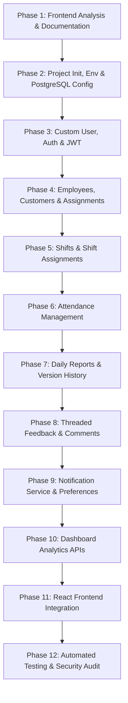

# WorkTrack Backend Implementation Plan

**Objective:** Build a robust, scalable Django REST Framework backend with PostgreSQL, Celery, and Simple JWT to replace frontend LocalStorage simulation without modifying the existing React UI design or layout.

---

## Roadmap & Phase Breakdown

---

### Phase 1: Analyze Frontend & Document Requirements (Status: COMPLETED)
- [x] Inspect existing React structure, state containers, and LocalStorage keys.
- [x] Create `backend/docs/FRONTEND_BACKEND_MAPPING.md`.
- [x] Create `backend/docs/DATABASE_DESIGN.md`.
- [x] Create `backend/docs/API_SPECIFICATION.md`.
- [x] Create `backend/docs/IMPLEMENTATION_PLAN.md`.

---

### Phase 2: Django Project Setup & Database Configuration
**Goal:** Initialize a clean Django 5 project inside `backend/` with PostgreSQL connection, decoupled settings, CORS, and Celery.
- **Tasks:**
  1. Create virtual environment `backend/.venv` using Python 3.12+.
  2. Create `backend/requirements.txt`:
     - `Django>=5.1,<5.2`
     - `djangorestframework>=3.15`
     - `psycopg[binary]>=3.2`
     - `djangorestframework-simplejwt>=5.3`
     - `django-cors-headers>=4.4`
     - `django-filter>=24.3`
     - `drf-spectacular>=0.27`
     - `python-decouple>=3.8`
     - `celery>=5.4`
     - `redis>=5.1`
     - `Pillow>=10.4`
     - `pytest>=8.3`, `pytest-django>=4.9`
  3. Initialize Django project `worktrack_api` and setup modular apps directory:
     - `apps.accounts`
     - `apps.employees`
     - `apps.customers`
     - `apps.assignments`
     - `apps.shifts`
     - `apps.attendance`
     - `apps.reports`
     - `apps.feedback`
     - `apps.notifications`
     - `apps.audit`
     - `apps.surveillance`
  4. Create `backend/.env.example` and `backend/.env`.
  5. Configure `DATABASES` with PostgreSQL, fallback to SQLite for CI/test isolation.
  6. Configure `CORS_ALLOWED_ORIGINS = ["http://localhost:5173", "http://127.0.0.1:5173"]`.
- **Validation:** `python manage.py check` passes with 0 issues.

---

### Phase 3: Custom User Model, Authentication & Permissions
**Goal:** Implement email-based authentication with role-based JWT tokens.
- **Tasks:**
  1. Define custom `User` model in `apps.accounts.models` with `ADMIN`, `EMPLOYEE`, `CUSTOMER` roles.
  2. Configure `AUTH_USER_MODEL = 'accounts.User'`.
  3. Implement `apps.accounts.serializers` with token claims (injecting role, user profile metadata into JWT token payload).
  4. Configure Simple JWT in settings with token rotation and blacklist.
  5. Implement endpoints:
     - `POST /api/v1/auth/login/`
     - `POST /api/v1/auth/refresh/`
     - `POST /api/v1/auth/logout/`
     - `GET /api/v1/auth/me/`
     - `POST /api/v1/auth/change-password/`
  6. Create reusable permissions: `IsAdmin`, `IsEmployee`, `IsCustomer`, `IsAdminOrReadOnly`.
- **Validation:** Run migration; execute tests for login, token verification, and role discrimination.

---

### Phase 4: Employees, Customers & Assignment Management
**Goal:** Implement staff and client business entities with administrative assignment workflow.
- **Tasks:**
  1. Create `EmployeeProfile` in `apps.employees` with employee code and department.
  2. Create `CustomerProfile` in `apps.customers` with customer code and timezone.
  3. Create `EmployeeCustomerAssignment` in `apps.assignments` with unique constraint on active pairs.
  4. Implement endpoints:
     - `/api/v1/employees/` (CRUD, status toggle)
     - `/api/v1/customers/` (CRUD, status toggle)
     - `/api/v1/assignments/` (create, list, `/approve/`, `/revoke/`)
- **Validation:** Admin can create employee and customer, assign them, and verify that duplicate active assignments are rejected.

---

### Phase 5: Shifts & Shift Scheduling
**Goal:** Define master shifts and calendar schedules.
- **Tasks:**
  1. Create `Shift` model (Morning: 06:00-14:00, Afternoon: 14:00-22:00, Night: 22:00-06:00).
  2. Create `ShiftAssignment` linking an active `EmployeeCustomerAssignment` to a shift on a date.
  3. Implement endpoints:
     - `/api/v1/shifts/`
     - `/api/v1/shift-assignments/` (filters: `date`, `employee`, `customer`)
     - `/api/v1/shift-assignments/my-shifts/`
- **Validation:** Schedule employee shifts, ensure non-active assignments cannot be scheduled.

---

### Phase 6: Attendance Punch Telemetry
**Goal:** Robust virtual punch-in/out engine with validation rules.
- **Tasks:**
  1. Create `Attendance` model linked one-to-one to `ShiftAssignment`.
  2. Implement business rules:
     - Only assigned employee can check in/out.
     - Check-in before check-out.
     - No duplicate check-in.
     - Check-out duration calculation in decimal hours.
  3. Implement endpoints:
     - `POST /api/v1/attendance/check-in/`
     - `POST /api/v1/attendance/check-out/`
     - `GET /api/v1/attendance/my-attendance/`
     - `GET /api/v1/attendance/` (Admin audit)
- **Validation:** Execute check-in and check-out test scenarios; verify duration and constraint enforcement.

---

### Phase 7: Daily Reports, Multi-Version Snapshots & Attachments
**Goal:** Operational reporting with audit history and file uploads.
- **Tasks:**
  1. Create `DailyReport`, `ReportVersion`, and `ReportAttachment` models in `apps.reports`.
  2. On every update: create an immutable `ReportVersion` entry with full JSON content snapshot and increment version counter.
  3. Implement endpoints:
     - `POST /api/v1/reports/`
     - `PATCH /api/v1/reports/{id}/`
     - `GET /api/v1/reports/` (filtered by role scope)
     - `GET /api/v1/reports/{id}/versions/`
     - `POST /api/v1/reports/{id}/attachments/`
- **Validation:** Create report (v1), edit twice (v2, v3), verify version snapshots match previous states.

---

### Phase 8: Threaded Feedback & Client Comments
**Goal:** Interactive two-way communication between customer and staff on shift reports.
- **Tasks:**
  1. Create `ReportComment` model in `apps.feedback` with `parent_comment` hierarchy.
  2. Implement authorization: Customer can comment only on their own reports; Employee can reply.
  3. Implement endpoints:
     - `GET /api/v1/reports/{id}/comments/`
     - `POST /api/v1/reports/{id}/comments/`
     - `POST /api/v1/comments/{id}/reply/`
- **Validation:** Post comment as customer, reply as employee, verify nested serialization.

---

### Phase 9: Notifications & Dispatch Engine
**Goal:** Event-driven notification logging with customer-configurable delivery cadences.
- **Tasks:**
  1. Create `Notification` and `NotificationPreference` models.
  2. Implement signals/service calls for:
     - Report submitted / updated
     - Feedback received / replied
     - Robbery hotspot anomaly flagged
  3. Celery tasks for periodic dispatch: Hourly, 6-Hour Digest, and Day-End Closeout.
  4. Endpoints:
     - `GET /api/v1/notifications/`
     - `GET /api/v1/notifications/unread-count/`
     - `POST /api/v1/notifications/{id}/read/`
     - `POST /api/v1/notifications/mark-all-read/`
     - `GET /api/v1/notification-preferences/`
     - `PATCH /api/v1/notification-preferences/`
- **Validation:** Trigger notification on report submit; test frequency configuration.

---

### Phase 10: CCTV Surveillance & Dashboard Analytics APIs
**Goal:** Deliver the US retail store hourly CCTV feeds and high-level role metrics.
- **Tasks:**
  1. Models for `SurveillanceBatch` and `CameraSnapshot` (10 camera feeds, robbery hotspots, AI confidence).
  2. Endpoints:
     - `/api/v1/surveillance/batches/`
     - `/api/v1/surveillance/snapshots/{id}/verify/`
     - `/api/v1/surveillance/batches/{id}/submit/`
     - `/api/v1/dashboard/admin/`
     - `/api/v1/dashboard/employee/`
     - `/api/v1/dashboard/customer/`
- **Validation:** Batch verification and metric calculations return accurate JSON structures.

---

### Phase 11: Frontend Integration
**Goal:** Connect the existing React frontend to Django APIs without UI disruption.
- **Tasks:**
  1. Create `src/services/apiClient.js` with Axios and JWT interceptors.
  2. Create modular API services: `authService`, `employeeService`, `customerService`, `reportService`, `attendanceService`, `surveillanceService`.
  3. Update `AuthContext.jsx` and `AppContext.jsx` to fetch real data from Django.
  4. Retain `localStorage` only for non-sensitive UI settings (e.g. sidebar collapse).
- **Validation:** Full manual and automated end-to-end tests across all 28 views.

---

### Phase 12: Automated Testing, Documentation & Security Audit
**Goal:** Production readiness, test coverage, and OpenAPI docs.
- **Tasks:**
  1. Pytest suite covering all apps, edge cases, IDOR protection, and permission boundaries.
  2. Swagger/OpenAPI setup via `drf-spectacular`.
  3. Seed management command `python manage.py seed_demo_data`.
  4. Complete `backend/README.md` and `.env.example`.
- **Validation:** 100% test pass rate, clean security audit.

