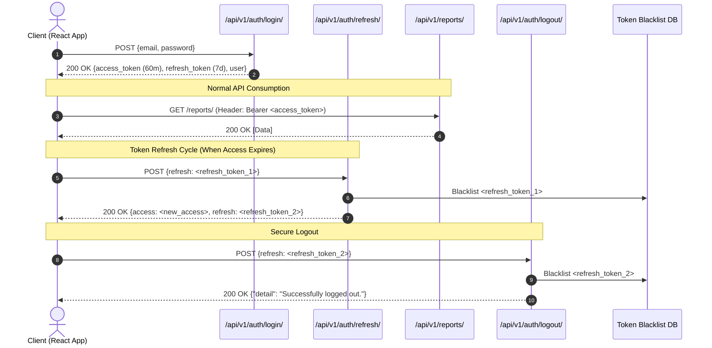

# 🔐 Authentication and Authorization Specification: WorkTrack

> **Security Standard:** RFC 7519 JSON Web Token (JWT)  
> **Auth Module:** Django REST Framework Simple JWT with Custom User Model & Token Rotation

---

## 1. Custom User Model Architecture

WorkTrack replaces Django's default `username`-based model with an email-centric identity model defined in `apps/accounts/models.py`:

```python
class User(AbstractUser):
    class Role(models.TextChoices):
        ADMIN = 'ADMIN', _('Administrator')
        EMPLOYEE = 'EMPLOYEE', _('Employee / Staff')
        CUSTOMER = 'CUSTOMER', _('Customer / Store Owner')

    id = models.UUIDField(primary_key=True, default=uuid.uuid4, editable=False)
    email = models.EmailField(_('email address'), unique=True, db_index=True)
    role = models.CharField(max_length=20, choices=Role.choices, default=Role.EMPLOYEE, db_index=True)
    
    USERNAME_FIELD = 'email'
    REQUIRED_FIELDS = ['username', 'first_name', 'last_name']
```

### Security Guardrails:
1. **Email Uniqueness:** Login identifier is strictly the verified email address.
2. **Immutable Role Assignment:** Non-admin users cannot alter their own `role` field. Profile updates explicitly exclude `role` from writable serializer fields.
3. **Soft Account Deactivation:** Disabling access sets `is_active = False`, immediately invalidating JWT issuance without destroying operational audit trails.

---

## 2. JWT Token Lifecycle & Configuration

The system uses `djangorestframework-simplejwt` configured in `settings.py`:

```python
SIMPLE_JWT = {
    'ACCESS_TOKEN_LIFETIME': timedelta(minutes=60),
    'REFRESH_TOKEN_LIFETIME': timedelta(days=7),
    'ROTATE_REFRESH_TOKENS': True,
    'BLACKLIST_AFTER_ROTATION': True,
    'UPDATE_LAST_LOGIN': True,
    'ALGORITHM': 'HS256',
    'SIGNING_KEY': SECRET_KEY,
    'AUTH_HEADER_TYPES': ('Bearer',),
    'USER_ID_FIELD': 'id',
    'USER_ID_CLAIM': 'user_id',
}
```



---

## 3. Role-Based Permission Architecture (RBAC)

Authorization is strictly enforced in Python on the backend via reusable DRF permission classes (`apps/accounts/permissions.py`):

```python
class IsAdmin(permissions.BasePermission):
    def has_permission(self, request, view):
        return bool(request.user and request.user.is_authenticated and 
                    (request.user.role == 'ADMIN' or request.user.is_staff))

class IsEmployee(permissions.BasePermission):
    def has_permission(self, request, view):
        return bool(request.user and request.user.is_authenticated and 
                    request.user.role == 'EMPLOYEE')

class IsCustomer(permissions.BasePermission):
    def has_permission(self, request, view):
        return bool(request.user and request.user.is_authenticated and 
                    request.user.role == 'CUSTOMER')
```

---

## 4. Multi-Tenant Scoping (IDOR Prevention)

In addition to endpoint permissions, every DRF `ViewSet.get_queryset()` method executes server-side tenancy scoping to prevent Insecure Direct Object References:

```python
def get_queryset(self):
    user = self.request.user
    qs = DailyReport.objects.select_related(...)
    
    # 1. Admins have global visibility
    if user.is_staff or user.role == 'ADMIN':
        return qs
        
    # 2. Employees see only their authored / assigned reports
    elif user.role == 'EMPLOYEE' and hasattr(user, 'employee_profile'):
        return qs.filter(
            shift_assignment__employee_customer_assignment__employee=user.employee_profile
        )
        
    # 3. Customers see only SUBMITTED reports for their facility
    elif user.role == 'CUSTOMER' and hasattr(user, 'customer_profile'):
        return qs.filter(
            shift_assignment__employee_customer_assignment__customer=user.customer_profile,
            status=DailyReport.Status.SUBMITTED
        )
        
    return qs.none()
```
*Tested and verified with automated test cases: unauthorized IDOR lookups return HTTP 404.*

---

## 5. Public Registration Workflow & Security Rules

Public user self-registration is enabled via `POST /api/v1/auth/register/` with strict guardrails:

```json
{
  "full_name": "Jane Doe",
  "email": "jane@example.com",
  "password": "SecurePassword123!",
  "confirm_password": "SecurePassword123!",
  "role": "EMPLOYEE",
  "company_name": ""
}
```

### Business Guardrails:
1. **Public Role Restriction:** Only `EMPLOYEE` and `CUSTOMER` roles may be created via public registration.
2. **Admin Creation Prohibition:** Any attempt to register with `role="ADMIN"` returns **HTTP 400 Bad Request** (`{"role": ["Administrator accounts cannot be created via public registration."]}`).
3. **Automatic Profile Generation:**
   - For `EMPLOYEE`: Creates linked `EmployeeProfile` with an auto-generated unique `employee_code` (`EMP-XXXXXX`) and defaults `joining_date` to today.
   - For `CUSTOMER`: Creates linked `CustomerProfile` with an auto-generated unique `customer_code` (`CUST-XXXXXX`) and requires `company_name`.
4. **Immediate JWT Issuance:** On HTTP 201 Created, access and refresh tokens are returned alongside the user profile for seamless onboarding.

---

## 6. Password Lifecycle & Account Recovery

### A. Password Reset Request (`POST /api/v1/auth/password-reset/`)
- Validates that email exists and account `is_active=True`.
- Generates a cryptographically signed token (`default_token_generator.make_token(user)`) and Base64 URL-encoded user ID (`urlsafe_base64_encode(user.pk)`).
- Dispatches reset link to user's email via Django `send_mail`.
- Returns HTTP 200 with timing-attack resistant confirmation response.

### B. Password Reset Confirmation (`POST /api/v1/auth/password-reset/confirm/`)
- Decodes `uid`, validates user existence, and verifies `token` integrity.
- Validates `new_password` against Django core password validators (minimum 8 characters, common password protection, numeric/similarity checks).
- Updates password using `user.set_password()` and saves. Token is automatically invalidated upon password change.

### C. In-App Password Change (`POST /api/v1/auth/change-password/`)
- Requires valid JWT authentication (`IsAuthenticated`).
- Validates `old_password` via `user.check_password()`.
- Validates `new_password` and matching `confirm_new_password`.

---

## 7. Frontend Integration & Protected Routes

1. **API Client (`src/services/apiClient.js`):**
   - Automatically attaches `Authorization: Bearer <access_token>` to outgoing requests.
   - Intercepts HTTP 401 Unauthorized errors and executes silent token refresh against `/api/v1/auth/refresh/`.
   - Re-dispatches original failed request upon successful token renewal.
2. **Context Layer (`src/context/AuthContext.jsx`):**
   - Provides global reactive `login`, `register`, `logout`, and user state.
   - Preserves offline/demo-persona instant switcher for college evaluator demonstrations.
3. **Route Guards (`src/components/common/ProtectedRoute.jsx`):**
   - Prevents unauthenticated access with stateful redirect to `/login`.
   - Enforces role-based permissions (`/admin/*`, `/employee/*`, `/customer/*`), redirecting unauthorized roles to their designated home dashboard.


