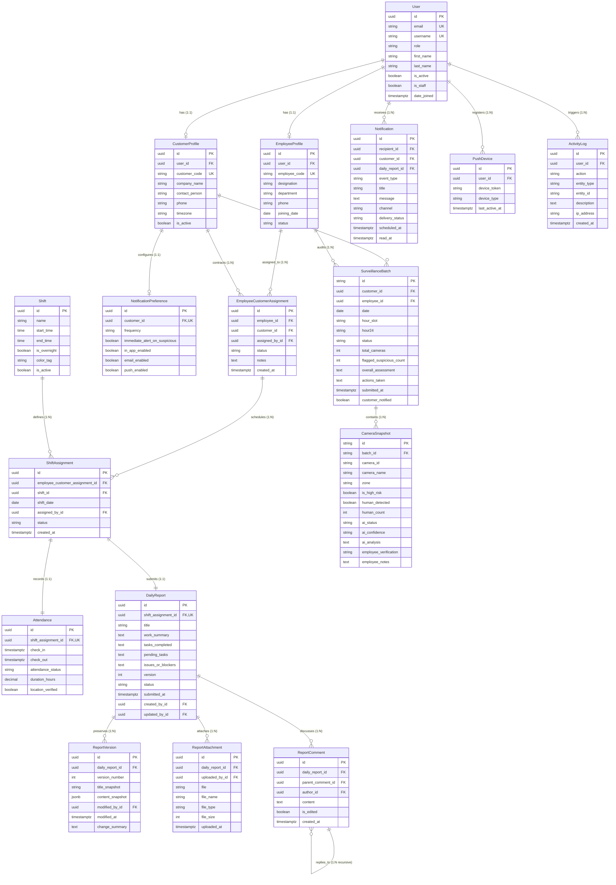

# 📊 Entity Relationship Diagram (ERD): WorkTrack

> **Format:** Mermaid ER Syntax  
> **Schema Version:** 1.0.0  
> **Consistency Reference:** Aligned with [DATABASE_DESIGN.md](DATABASE_DESIGN.md)

---

## 1. Visual Entity Relationship Diagram

---

## 2. Cardinality Analysis & Relationship Rules

1. **User to Profiles (1:1 Optional):** A user has at most one profile type (`EmployeeProfile` if role is `EMPLOYEE`, or `CustomerProfile` if role is `CUSTOMER`). Administrators do not require a sub-profile.
2. **Employee to Customer Allocation (M:N via Intermediary):** Governed exclusively by `EmployeeCustomerAssignment`. Prevents duplicate active contracts with database-level uniqueness.
3. **ShiftAssignment to Attendance (1:1 Strict):** An attendance punch cannot exist without an underlying scheduled shift.
4. **ShiftAssignment to DailyReport (1:1 Strict):** Exactly one daily report is filed per shift, ensuring a direct 1-to-1 operational pairing between time on site and work completed.
5. **DailyReport to ReportVersion (1:N Compositional):** Deleting a daily report cascades to its versions, but modifying a report appends to `ReportVersion` without destructive overwrites.
6. **Threaded Comment Hierarchy (Recursive 1:N):** `ReportComment.parent_comment_id` points to `ReportComment.id`, enabling multi-level nested replies between store owners and staff.
7. **Surveillance Batch to Snapshots (1:10 Fixed Aggregate):** Each hourly batch aggregates 10 camera frame records corresponding to the physical store's camera layout.

