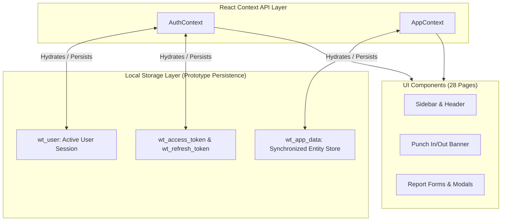

# 💻 Frontend Architecture & Documentation: WorkTrack

> **Technology Stack:** React 19.3.1, Vite 8.3.5, React Router DOM 7.18.5, Tailwind CSS 3.4.19, Recharts 3.10.1, Lucide React 1.65.0  
> **State Management:** React Context API (`AuthContext`, `AppContext`) & LocalStorage fallback

---

## 1. Project Directory Topology

```text
src/
├── App.jsx                     # Top-level Router configuration & layout mounting
├── main.jsx                    # Application entry point with React 19 DOM root
├── index.css                   # Tailwind CSS imports & custom scrollbar/utility classes
├── assets/                     # Static icons, logos, and illustration assets
├── components/
│   ├── common/
│   │   ├── ErrorBoundary.jsx   # Top-level React error boundary for crash prevention
│   │   ├── Header.jsx          # Dynamic navigation header with quick role switcher
│   │   ├── Sidebar.jsx         # Responsive multi-role navigation sidebar
│   │   ├── Card.jsx            # Standardized surface container component
│   │   ├── Badge.jsx           # Status badge tag with dynamic color variants
│   │   └── Modal.jsx           # Reusable accessible backdrop modal
│   ├── reports/
│   │   ├── CommentThread.jsx   # Threaded customer feedback and guard replies
│   │   └── VersionHistory.jsx  # Slide-over drawer displaying immutable report revisions
│   └── surveillance/
│       ├── CameraCard.jsx      # CCTV frame card with AI human tags & verification buttons
│       └── ZoneMap.jsx         # Interactive US Retail Store multi-zone layout diagram
├── context/
│   ├── AuthContext.jsx         # Session state, JWT storage, and instant role switcher
│   └── AppContext.jsx          # Cross-cutting application state & notification badge store
├── data/
│   └── mockData.js             # High-fidelity demo datasets (10 cameras, shifts, reports)
├── layouts/
│   ├── AdminLayout.jsx         # Layout wrapper with Admin navigation and breadcrumbs
│   ├── EmployeeLayout.jsx      # Layout wrapper with Guard navigation and punch status
│   └── CustomerLayout.jsx      # Layout wrapper with Client navigation and store branding
└── pages/
    ├── auth/
    │   └── Login.jsx           # Split-screen responsive login portal with 1-click demo logins
    ├── admin/                  # 10 Admin management and monitoring pages
    ├── employee/               # 9 Field worker / guard shift and surveillance pages
    └── customer/               # 9 Client transparency, reports, and notification pages
```

---

## 2. Complete Route Map (28 Routes)

### 2.1 Public & Authentication Routes
* `/`: `RootRedirect` $\rightarrow$ Redirects authenticated users to their role portal, or `/login`.
* `/login`: `Login.jsx` $\rightarrow$ Authentication view with instant role buttons for Admin, Employee, and Customer.

### 2.2 Admin Portal (`/admin/*`) — Wrapped in `<AdminLayout />`
* `/admin`: `AdminOverview.jsx` $\rightarrow$ High-level operational KPIs, 7-day attendance chart, shift distribution, recent reports.
* `/admin/employees`: `EmployeeManagement.jsx` $\rightarrow$ Staff directory, onboarding modal, deactivation controls.
* `/admin/customers`: `CustomerManagement.jsx` $\rightarrow$ Client store registry, timezone configurations, store codes.
* `/admin/assignments`: `EmployeeAssignments.jsx` $\rightarrow$ Employee-to-customer contract allocation matrix.
* `/admin/shifts`: `ShiftManagement.jsx` $\rightarrow$ Shift template builder and daily roster calendar.
* `/admin/attendance`: `AttendanceMonitoring.jsx` $\rightarrow$ Biometric punch records, status filters (`PRESENT`, `LATE`).
* `/admin/reports`: `DailyReportsMonitoring.jsx` $\rightarrow$ Cross-tenant daily report feed with version history modal.
* `/admin/feedback`: `FeedbackMonitoring.jsx` $\rightarrow$ Global customer comments and staff responses.
* `/admin/notifications`: `AdminNotifications.jsx` $\rightarrow$ System-wide notification dispatch logs.
* `/admin/settings` & `/admin/profile`: `AdminSettings.jsx` $\rightarrow$ Operational parameters, agency branding.

### 2.3 Employee Portal (`/employee/*`) — Wrapped in `<EmployeeLayout />`
* `/employee`: `EmployeeOverview.jsx` $\rightarrow$ Assigned store card, today's shift briefing, punch-in/out banner.
* `/employee/surveillance`: `HourlySurveillance.jsx` $\rightarrow$ 1-hour inspection package: 10 CCTV camera frames with AI telemetry.
* `/employee/shifts`: `MyShifts.jsx` $\rightarrow$ Upcoming shift calendar and past shift history.
* `/employee/attendance`: `EmployeeAttendance.jsx` $\rightarrow$ Personal punch logs, total hours worked, status flags.
* `/employee/daily-report`: `DailyReportForm.jsx` $\rightarrow$ Rich shift report editor with checklist and version indicator.
* `/employee/history`: `ReportHistory.jsx` $\rightarrow$ Archive of past submitted reports with revision viewer.
* `/employee/feedback`: `EmployeeFeedback.jsx` $\rightarrow$ Customer comments requiring replies.
* `/employee/notifications`: `EmployeeNotifications.jsx` $\rightarrow$ Personal shift alerts and task reminders.
* `/employee/profile`: `EmployeeProfile.jsx` $\rightarrow$ Personal details, badge code (`EMP-AARAV`), phone.

### 2.4 Customer Portal (`/customer/*`) — Wrapped in `<CustomerLayout />`
* `/customer`: `CustomerOverview.jsx` $\rightarrow$ On-duty guard summary, coverage rate, CCTV incident badges.
* `/customer/surveillance`: `CustomerSurveillance.jsx` $\rightarrow$ Real-time surveillance audit feed across 10 store cameras.
* `/customer/employees`: `CustomerAssignedEmployees.jsx` $\rightarrow$ Profiles and photos of staff assigned to the store.
* `/customer/reports`: `CustomerDailyReports.jsx` $\rightarrow$ Chronological feed of submitted daily work reports.
* `/customer/shift-reports`: `CustomerShiftReports.jsx` $\rightarrow$ Side-by-side Morning vs. Afternoon vs. Night comparison.
* `/customer/feedback`: `CustomerFeedback.jsx` $\rightarrow$ Direct communication thread with on-duty staff.
* `/customer/notifications`: `CustomerNotifications.jsx` $\rightarrow$ Delivered shift reports and security alerts.
* `/customer/settings`: `CustomerNotificationSettings.jsx` $\rightarrow$ Digest cadence (Instant, Hourly, 6-Hour, Daily).
* `/customer/profile`: `CustomerProfile.jsx` $\rightarrow$ Store location, operating hours, primary contact.

---

## 3. State Management Architecture



* **Instant Role Switcher:** For rapid evaluative demonstration without re-entering credentials, `<Header />` provides an instant role switcher that invokes `switchRole('admin' | 'employee' | 'customer')`, updating both `AuthContext` and router redirects seamlessly.

---

## 4. Future API Client Integration Strategy

During full backend wiring:
1. An Axios/Fetch interceptor (`src/services/apiClient.js`) replaces local state modifications.
2. The client automatically injects `Authorization: Bearer <token>` on all outgoing requests.
3. Upon receiving HTTP 401, the interceptor transparently issues a refresh request to `/api/v1/auth/refresh/` and retries the original request without user interruption.
4. UI layouts, Tailwind styling, route guards, and component structure remain 100% preserved.

