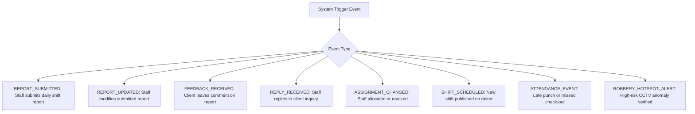
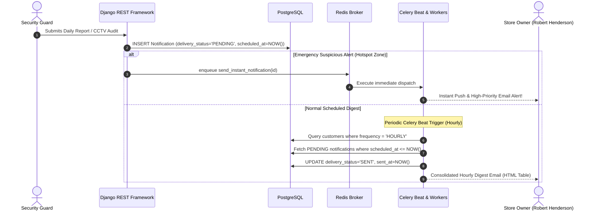

# 🔔 Notification System & Multi-Cadence Digest Engine: WorkTrack

> **Architecture:** Multi-Channel Asynchronous Dispatch (In-App, SMTP Email, WebPush)  
> **Scheduler:** Celery Beat with Redis Message Queue & Tenancy Preferences

---

## 1. Notification Event Taxonomy

The system defines 8 distinct system event types in `apps/notifications/models.py`:

---

## 2. Customer Notification Preferences

Every customer store maintains an individual `NotificationPreference` record:

| Field | Configuration Choices | Description |
| :--- | :--- | :--- |
| `frequency` | `INSTANT`, `HOURLY`, `6HOURS`, `DAILY` | Primary cadence for non-emergency shift notifications. |
| `immediate_alert_on_suspicious` | `BOOLEAN (Default True)` | **Emergency Robbery Override:** When enabled, suspicious activity in high-risk zones (Cash Registers, Safe Room) bypasses digests and alerts immediately. |
| `in_app_enabled` | `BOOLEAN (Default True)` | Displays alerts in the header notification bell drawer. |
| `email_enabled` | `BOOLEAN (Default True)` | Sends formatted HTML email digests via SMTP. |
| `push_enabled` | `BOOLEAN (Default True)` | Dispatches browser WebPush notifications. |

---

## 3. Asynchronous Dispatch & Digest Pipeline

---

## 4. Delivery Status & Audit Trail

Every notification record tracks its delivery lifecycle:
* `PENDING`: Persisted in database; awaiting next scheduled digest trigger or instant worker pickup.
* `SENT`: Successfully transmitted over SMTP or WebPush gateway.
* `FAILED`: Network or credential failure during dispatch (eligible for automatic retry up to 3 times).
* `READ`: User clicked on or opened the notification in the application UI (`read_at` recorded).

### Notification REST Endpoints:
* `GET /api/v1/notifications/`: Paginated feed of notifications for logged-in user.
* `GET /api/v1/notifications/unread_count/`: Light count query powering header badges.
* `POST /api/v1/notifications/{id}/mark_as_read/`: Sets `read_at = NOW()`, `delivery_status = 'READ'`.
* `POST /api/v1/notifications/mark_all_read/`: Bulk updates all unread notifications.
* `GET, PUT /api/v1/notifications/preferences/my_preference/`: Client digest configuration.

