# 📋 Project Overview: WorkTrack

> **Document Status:** `CONFIRMED SPECIFICATION`  
> **System Name:** WorkTrack (Smart Workforce, Attendance, Shift Management & Daily Reporting System)  
> **Target Scenario:** Multi-Site Retail, Facility Management & US Retail Store CCTV Security Audits

---

## 1. Executive Summary

**WorkTrack** is a centralized, role-based workforce orchestration and field transparency platform. It bridges the critical operational divide between enterprise administrators, frontline staff (employees/guards), and business clients (store owners/customers). 

Originally conceived to overcome the limitations of manual punch cards, paper shift logs, and fragmented WhatsApp communication, WorkTrack delivers an integrated digital ecosystem providing **tamper-proof biometric attendance**, **flexible shift scheduling**, **version-tracked daily work reports**, **bidirectional feedback**, and **hourly AI-assisted video surveillance audits**.

```mermaid
flowchart LR
    subgraph Admins["1. Administrators"]
        A1[Manage Master Staff]
        A2[Define Shift Templates]
        A3[Allocate Staff to Clients]
        A4[Oversee Global Analytics]
    end

    subgraph Employees["2. Field Employees / Staff"]
        E1[Check-In / Out of Shifts]
        E2[Draft & Submit Daily Reports]
        E3[Audit 10 CCTV Feeds Hourly]
        E4[Reply to Customer Feedback]
    end

    subgraph Customers["3. Customers / Store Owners"]
        C1[View Active Staff on Duty]
        C2[Inspect Daily Work Reports]
        C3[Review Verified Camera Audits]
        C4[Leave Threaded Feedback]
    end

    Admins -->|Schedules & Allocates| Employees
    Employees -->|Delivers Service & Reports| Customers
    Customers -->|Receives Audits & Insights| Admins
```



---

## 2. Problem Statement

Organizations employing distributed or on-site shift workers (e.g., retail store security, facility maintenance, outsourced IT support) encounter significant operational obstacles:

1. **Time Theft & Attendance Fraud ("Ghost Punching"):** Employees often record inaccurate check-in/out times on unverified logs or paper sheets, resulting in inflated payroll and unmonitored premises.
2. **Shift Scheduling Bottlenecks:** Coordinating multi-shift rosters across morning, afternoon, and overnight cycles with changing customer allocations is error-prone when managed through spreadsheets.
3. **Opaque & Fleeting Daily Reporting:** Traditional daily logs sent over email or messaging apps get lost, lack standardized checklists, cannot be audited for historical revisions, and prevent historical trend analysis.
4. **Surveillance Operator Fatigue:** In retail security scenarios (e.g., US retail stores facing cash register robberies and safe room theft), security personnel cannot stare at 10+ live camera monitors 24/7 without missing anomalies.
5. **Customer Disconnection:** Store owners lack real-time visibility into whether assigned guards actually showed up, what tasks were completed during a shift, or whether security anomalies occurred.

---

## 3. Proposed Solution

WorkTrack resolves these challenges through a unified three-portal architecture:

* **Centralized Allocation & Shift Rostering:** Administrators establish explicit `EmployeeCustomerAssignment` pairings and generate structured shift schedules linked to specific time windows.
* **Strict Two-Stage Attendance Verification:** Staff can only check in if assigned to an active shift. Duplicate check-ins are programmatically prohibited. Check-out auto-computes shift duration in UTC and requires prior check-in.
* **Immutable Versioned Daily Reports:** Every shift assignment requires exactly one daily report. Staff can update reports after submission, but every modification generates a permanent, timestamped snapshot (`ReportVersion`) detailing what changed and by whom.
* **Hourly AI CCTV Surveillance Cadence:** Every hour, an automated computer vision snapshot across 10 store zones is pre-analyzed for human presence and anomalies. A remote security operator inspects each snapshot, verifies or overrides the AI finding, logs actions taken, and submits the hourly audit report.
* **Customer Digest Delivery:** Customers configure their notification preferences (Instant, Hourly, 6-Hour Shift Digest, or Day-End Closeout) with an emergency override that immediately notifies them if a high-risk zone (Cash Register, Safe Room) is flagged suspicious.

---

## 4. Target Users & Personas

### 1. System Administrator (`ADMIN`)
* **Persona:** Operations Manager, Security Agency Director, HR Head.
* **Needs:** Total system oversight, employee onboarding, customer registration, contract allocation, shift template definition, attendance audits, and organization-wide KPI dashboards.
* **Key Actions:** Create/deactivate users, assign employees to customers, generate shift schedules, view aggregated attendance rates, and inspect activity logs.

### 2. Frontline Employee (`EMPLOYEE`)
* **Persona:** On-site Guard, Shift Supervisor, Retail Field Specialist (e.g., Aarav Shah, EMP-AARAV).
* **Needs:** Simple, mobile-friendly interface to punch in/out, view daily roster, draft daily activity reports, upload photo attachments, review CCTV snapshots, and respond to customer comments.
* **Key Actions:** Check-in, check-out, draft report, submit report, verify camera snapshot, submit surveillance batch, post comment reply.

### 3. Customer / Client (`CUSTOMER`)
* **Persona:** Retail Store Owner, Facility Manager, Franchisee (e.g., Robert Henderson, Acme Store #104).
* **Needs:** Transparent proof-of-work, staff accountability, live roster view, access to submitted daily reports, hourly camera audit telemetry, and feedback communication.
* **Key Actions:** View assigned staff, read daily shift reports, view versions, verify surveillance logs, post feedback comments, configure notification digests.

---

## 5. Core Functional Modules

```text
WorkTrack Modular Architecture:
├── 1. Accounts & Authentication    (JWT, Custom User, Role Enforcement)
├── 2. Employee Management          (Profiles, Codes, Designations, Status)
├── 3. Customer Management          (Profiles, Timezones, Store Metadata)
├── 4. Contract Allocations         (Admin-governed Employee-Customer Pairings)
├── 5. Shift Scheduling             (Templates, Dates, Status Transitions)
├── 6. Attendance Engine            (Sequential Punch Validation, UTC Durations)
├── 7. Daily Reporting & Auditing   (One-to-One Reports, Immutable Snapshots)
├── 8. Threaded Feedback            (Customer Comments & Staff Replies)
├── 9. Hourly CCTV Surveillance     (10 Cameras, AI Telemetry, Human Audit)
├── 10. Multi-Cadence Notifications (Instant, Hourly, 6-Hour, Daily Digests)
└── 11. Role Analytics Dashboards   (Admin KPIs, Employee Roster, Customer Feeds)
```

---

## 6. Project Scope Boundaries

### In-Scope (Implemented & Core Deliverables)
* Responsive React single-page application with Admin, Employee, and Customer portal screens. Admin employee, customer, assignment, shift-template, and employee-schedule management is API-backed; other operational screens remain demo/local-storage workflows pending later integration phases.
* Django 5.1 REST API modules with SimpleJWT authentication; frontend integration is being delivered in phases rather than considered complete.
* PostgreSQL relational schema and migrations across 11 modular apps.
* Role-based permissions (`IsAdmin`, `IsEmployee`, `IsCustomer`) and scoped employee/customer profile lists.
* Full attendance lifecycle validation and error handling.
* Complete report versioning system preserving full JSON snapshots.
* Threaded comment discussions on reports.
* Hourly CCTV audit workflow using seeded/simulated camera telemetry; this is not connected to physical cameras or a computer-vision engine.
* Notification preference management (Instant, Hourly, 6-Hour, Daily).
* OpenAPI 3.0 / Swagger interactive documentation via `drf-spectacular`.
* Backend automated tests covering authentication, attendance, reports, API isolation, surveillance, dashboards, and Phase 1 admin CRUD workflows.

### Current Integration Status
Phases 1 and 2 are integrated: Admin employee/customer/employee-customer assignment and shift template/schedule workflows use Django APIs. Employees can view their own scheduled shifts, and customers can query only schedules assigned to their account. Shift templates include working days and overnight support; the backend rejects invalid dates and overlapping employee schedules. User passwords are set through the backend and stored as Django password hashes; deactivating an employee/customer also disables their login. Frontend demo shortcuts require `VITE_ENABLE_DEMO_MODE=true`; by default the login form uses backend authentication only.

Attendance, reports, broader customer operations, and notifications still have frontend screens and backend APIs but are not yet fully wired together. Their UI may display or persist sample state in browser local storage. Do not treat those screens or the simulated CCTV feed as production workflows until the corresponding integration phases are complete.

### Out-of-Scope (Deferred to Future Iterations)
* Native mobile apps (iOS / Android) — currently addressed via responsive Web SPA.
* Physical hardware biometric device SDK integration (uses mobile GPS/browser timestamping).
* Live WebRTC real-time RTSP video streaming (operates via periodic snapshot telemetry).
* Automated payroll payment disbursement (provides exported attendance hours for payroll).
* Third-party SMS gateway billing (uses In-App notifications and SMTP email).

---

## 7. Expected Outcomes & ROI

These are product objectives, not measured results. Admin master-data workflows are currently integrated; other operational screens remain demo/local-storage workflows, and surveillance telemetry is simulated. No attendance, incident-response, or ROI reduction has been verified.

1. **100% Elimination of Attendance Discrepancies:** Automated server-side validation eliminates unverified or overlapping shift claims.
2. **Auditable Operational Accountability:** Report version snapshots protect both client and agency in the event of disputed incidents.
3. **90% Reduction in Robbery Hotspot Response Latency:** Hourly AI surveillance coupled with human verification ensures anomalies (unattended cash drawers, safe room breaches) are addressed within minutes rather than discovering them days later.
4. **Enhanced Client Trust & Retention:** Providing store owners with transparent shift feeds and direct feedback threads creates long-term client loyalty.
