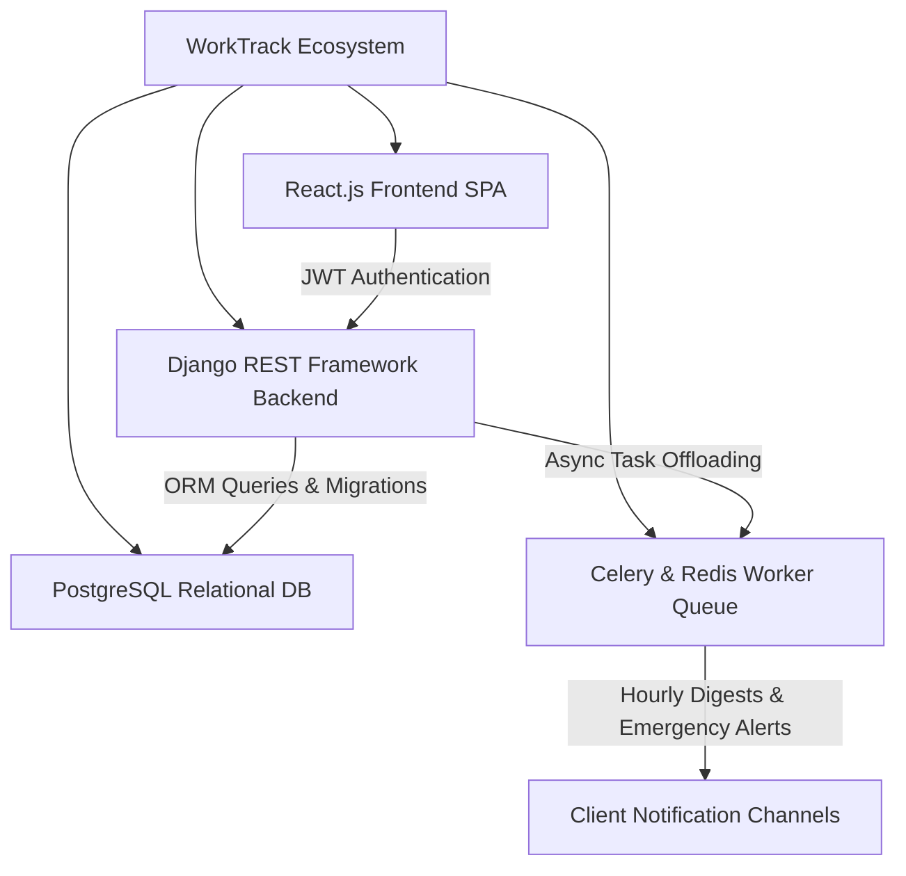

# 🏢 WorkTrack: Documentation Hub

> **Smart Workforce, Attendance, Shift Management & Daily Reporting System**  
> Tailored for Multi-Site Operations, US Retail Store CCTV Audits & Transparent Hourly Surveillance.

[](FRONTEND_DOCUMENTATION.md)
[](BACKEND_DOCUMENTATION.md)
[](DATABASE_DESIGN.md)
[](API_DOCUMENTATION.md)
[-emerald.svg)](TESTING_STRATEGY.md)

---

## 📌 Introduction

**WorkTrack** is an enterprise-grade workforce management platform designed to solve operational coordination, biometric attendance fraud, shift scheduling friction, and opaque daily activity reporting across distributed client locations. In particular, it features specialized capabilities for **US Retail Store Security & Hourly Camera Snapshot Surveillance with AI Human Detection & Robbery Prevention**.

This directory houses the comprehensive architectural, technical, engineering, and operational documentation for the WorkTrack system.



---

## 🎯 Key Objectives

1. **Role-Based Operational Clarity:** Provide tailored experiences for three key personas: **Admin**, **Employee (Staff / Security Guard)**, and **Customer (Store Owner)**.
2. **Tamper-Resistant Attendance:** Eliminate ghost shifts with sequential validation: check-in must precede check-out, duplicate check-ins are rejected, and durations are calculated server-side in UTC.
3. **Traceable Daily Reporting:** Guarantee complete transparency with immutable version snapshots (`ReportVersion`) preserved on every edit.
4. **Hourly Surveillance Auditing:** Bridge CCTV AI computer vision telemetry with human operator verification across high-risk store zones.
5. **Configurable Digest Notification Cadence:** Give clients control over communication density (Instant, Hourly, 6-Hour Shift, or Day-End digests) with emergency robbery overrides.

---

## 🗂️ Documentation Directory Index

| File | Document | Description |
| :--- | :--- | :--- |
| `01` | [PROJECT_OVERVIEW.md](PROJECT_OVERVIEW.md) | Problem statement, proposed solution, target personas, and scope boundaries. |
| `02` | [REQUIREMENTS.md](REQUIREMENTS.md) | Comprehensive functional (FR) and non-functional (NFR) requirements catalog. |
| `03` | [SOFTWARE_REQUIREMENTS_SPECIFICATION.md](SOFTWARE_REQUIREMENTS_SPECIFICATION.md) | Formal academic/enterprise SRS document for final-year submission. |
| `04` | [SYSTEM_ARCHITECTURE.md](SYSTEM_ARCHITECTURE.md) | Architectural topology, tier interactions, request-response lifecycles, and diagrams. |
| `05` | [DATABASE_DESIGN.md](DATABASE_DESIGN.md) | PostgreSQL schema, model attributes, indexes, constraints, and relationships. |
| `06` | [ER_DIAGRAM.md](ER_DIAGRAM.md) | Complete Entity-Relationship visual diagrams in Mermaid format. |
| `07` | [API_DOCUMENTATION.md](API_DOCUMENTATION.md) | Django REST Framework API contract, pagination, error schemas, and OpenAPI specs. |
| `08` | [API_ENDPOINT_MAPPING.md](API_ENDPOINT_MAPPING.md) | Matrix mapping every frontend React route and action to backend `/api/v1/` routes. |
| `09` | [AUTHENTICATION_AND_AUTHORIZATION.md](AUTHENTICATION_AND_AUTHORIZATION.md) | Custom User model, email login, SimpleJWT token rotation, and RBAC permissions. |
| `10` | [BUSINESS_LOGIC.md](BUSINESS_LOGIC.md) | Comprehensive operational business rules and constraints. |
| `11` | [USER_ROLES_AND_PERMISSIONS.md](USER_ROLES_AND_PERMISSIONS.md) | CRUD privilege matrix across Admin, Employee, and Customer roles. |
| `12` | [FRONTEND_DOCUMENTATION.md](FRONTEND_DOCUMENTATION.md) | React 19 architecture, Vite setup, Tailwind CSS theme, and router tree. |
| `13` | [BACKEND_DOCUMENTATION.md](BACKEND_DOCUMENTATION.md) | Django 5.x app structure, serializers, views, permissions, and settings. |
| `14` | [NOTIFICATION_SYSTEM.md](NOTIFICATION_SYSTEM.md) | Multi-channel dispatch engine, client digest preferences, and Celery tasks. |
| `15` | [SECURITY_GUIDELINES.md](SECURITY_GUIDELINES.md) | IDOR defenses, role isolation, password hashing, and CORS/CSRF safeguards. |
| `16` | [TESTING_STRATEGY.md](TESTING_STRATEGY.md) | Automated testing plan using pytest, pytest-django, and coverage metrics. |
| `17` | [DEVELOPMENT_SETUP.md](DEVELOPMENT_SETUP.md) | Windows development guide for setting up Node, Python, and PostgreSQL. |
| `18` | [DEPLOYMENT_GUIDE.md](DEPLOYMENT_GUIDE.md) | Production Docker Compose deployment, Gunicorn, Nginx, HTTPS, and backup guidance. |
| `19` | [DEVELOPMENT_ROADMAP.md](DEVELOPMENT_ROADMAP.md) | Phased implementation schedule, milestones, and status indicators. |
| `20` | [CODING_GUIDELINES.md](CODING_GUIDELINES.md) | PEP 8, DRF conventions, React component standards, and Git commit formats. |
| `21` | [CHANGELOG.md](CHANGELOG.md) | Semantic version release history and completed deliverables. |
| `22` | [OPEN_QUESTIONS.md](OPEN_QUESTIONS.md) | Catalog of open architectural decisions, assumptions, and edge cases. |

---

## 🚀 Quick Execution Guide

### 1. Running the React Frontend
```powershell
# In project root
npm install
npm run dev
# Accessible at http://localhost:5173/
```

### 2. Running the Django Backend
```powershell
# Navigate to backend directory
cd backend

# Activate virtual environment
.\.venv\Scripts\Activate.ps1

# Install dependencies
pip install -r requirements.txt

# Run migrations
python manage.py migrate

# Seed demo data
python manage.py seed_demo_data

# Start development server
python manage.py runserver 8000
# API root: http://127.0.0.1:8000/api/v1/
# Swagger UI: http://127.0.0.1:8000/api/v1/docs/
```

### 3. Running Automated Tests
```powershell
cd backend
python -m pytest
```

---

## 👥 Demo Personas & Credentials

| Role | Email Address | Password | Default Persona Name |
| :--- | :--- | :--- | :--- |
| **Admin** | `admin@worktrack.demo` | `admin123` | System Administrator |
| **Employee** | `employee@worktrack.demo` | `employee123` | Aarav Shah (EMP-AARAV) |
| **Customer** | `customer@worktrack.demo` | `customer123` | Robert Henderson (Acme Store #104) |
