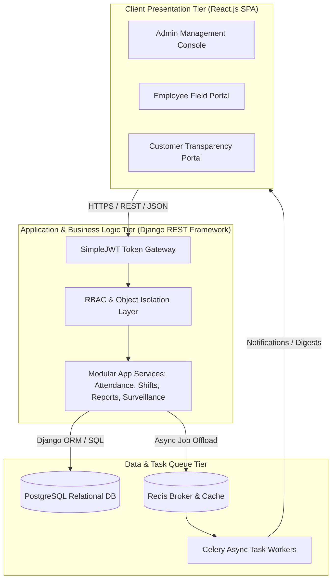
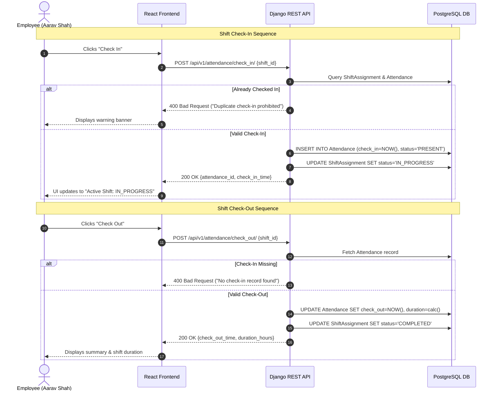
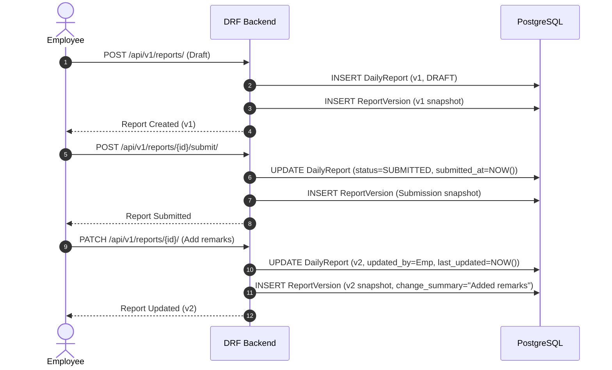

# 🎓 Software Requirements Specification (SRS)
## For WorkTrack: Smart Workforce, Attendance, Shift Management & Daily Reporting System

> **Document Type:** Formal System Requirements Specification (IEEE Std 830-1998 Format)  
> **Prepared For:** Academic Evaluation / Final-Year Computer Science Engineering Project  
> **Author:** Development Team (Harshil Patel & Engineering Cohort)  
> **Status:** Version 1.0 (Final Approved)  
> **Date:** Academic Year 2026–2027

---

## 1. Introduction

### 1.1 Purpose
This Software Requirements Specification (SRS) document provides a formal, comprehensive description of the software architecture, functional capabilities, interface specifications, data models, and non-functional requirements for the **WorkTrack** software suite. It serves as the primary technical baseline for software developers, quality assurance engineers, project evaluators, and system administrators throughout the development, testing, and deployment lifecycle.

### 1.2 Scope
WorkTrack is a distributed, multi-tiered enterprise workforce management application designed to coordinate distributed field workers, automate shift scheduling, enforce tamper-proof biometric attendance verification, provide immutable version-tracked daily operational reporting, and deliver hourly AI-assisted surveillance audits for high-risk retail stores. 

The software system comprises:
1. A Single Page Application (SPA) frontend developed with **React.js 19**, **Vite**, **Tailwind CSS**, and **Lucide React**.
2. A RESTful application programming interface (API) backend implemented using **Python 3.12+**, **Django 5.x**, and **Django REST Framework (DRF)**.
3. An enterprise relational database tier powered by **PostgreSQL**.
4. An asynchronous background task execution engine leveraging **Celery** and **Redis**.

### 1.3 Definitions, Acronyms, and Abbreviations
* **API:** Application Programming Interface
* **ATS:** Applicant Tracking System / Automated Task Scheduler
* **CCTV:** Closed-Circuit Television
* **CORS:** Cross-Origin Resource Sharing
* **CRUD:** Create, Read, Update, Delete
* **DRF:** Django REST Framework
* **FIFO:** First In, First Out
* **IDOR:** Insecure Direct Object Reference
* **JSON:** JavaScript Object Notation
* **JWT:** JSON Web Token
* **ORM:** Object-Relational Mapping
* **RBAC:** Role-Based Access Control
* **SPA:** Single Page Application
* **SRS:** Software Requirements Specification
* **UTC:** Coordinated Universal Time
* **UUID:** Universally Unique Identifier

---

## 2. Overall Description

### 2.1 Product Perspective
WorkTrack operates as an independent, self-contained multi-tenant enterprise system designed to run on cloud computing infrastructure (e.g., AWS, DigitalOcean, or private servers). It replaces informal, disconnected tools (paper timesheets, email attachments, and messaging apps) with a unified, role-governed portal.

### 2.2 User Classes and Characteristics

| User Class | Description | Technical Proficiency | Access Level |
| :--- | :--- | :--- | :--- |
| **System Administrator** | Agency executives, HR directors, and operations managers responsible for master data, billing, staff assignments, and global compliance. | Moderate to High | Full administrative permissions across all tenants, models, and system logs. |
| **Field Employee** | Security guards, shift technicians, and retail staff working on site who log attendance, submit shift reports, and audit surveillance snapshots. | Basic (Mobile/Desktop Web) | Restricted to assigned shifts, own attendance, own reports, and assigned customer comment threads. |
| **Customer / Client** | Business owners, store managers, and facility clients who verify contracted staff attendance, review submitted reports, and inspect security audits. | Basic to Moderate | Read-only access to assigned staff and submitted reports; write access to feedback comments and notification settings. |

### 2.3 Operating Environment
* **Frontend Runtime:** Modern evergreen web browsers supporting ECMAScript 2022+ (Google Chrome 110+, Mozilla Firefox 110+, Apple Safari 16+, Microsoft Edge 110+).
* **Backend Runtime:** Python 3.12 or 3.13 on Linux (Ubuntu 22.04 LTS / Debian 12) or Windows 10/11 Server.
* **Database Management System:** PostgreSQL 15+ (with SQLite 3.38+ support for local development).
* **Message Broker:** Redis 7.x.

---

## 3. Specific System Requirements

### 3.1 System Features & Detailed Use Cases

#### Use Case UC-01: Employee Shift Check-In & Check-Out
* **Primary Actor:** Field Employee.
* **Pre-conditions:** The employee is authenticated via valid JWT; an active `ShiftAssignment` exists for the current calendar date; status is `SCHEDULED`.
* **Main Success Scenario:**
  1. Employee navigates to their dashboard or attendance view.
  2. Employee clicks "Check In".
  3. System validates that the employee owns the assignment and has not already checked in.
  4. System records `check_in = timezone.now()` in UTC and creates an `Attendance` record with `attendance_status = 'PRESENT'`.
  5. System updates `ShiftAssignment.status = 'IN_PROGRESS'`.
  6. At end of shift, employee clicks "Check Out".
  7. System validates check-in exists and check-out is currently null.
  8. System records `check_out = timezone.now()` in UTC.
  9. System calculates `duration_hours = (check_out - check_in) / 3600` rounded to two decimal places.
  10. System updates `ShiftAssignment.status = 'COMPLETED'`.
* **Post-conditions:** Attendance is persisted; shift assignment is completed.
* **Exception Flows:**
  * *E1 (Duplicate Check-In):* Employee attempts to check in twice $\rightarrow$ System rejects with HTTP 400: *"Duplicate check-in is not allowed."*
  * *E2 (Premature Check-Out):* Employee attempts check-out without prior check-in $\rightarrow$ System rejects with HTTP 400: *"Cannot check out without check-in."*

#### Use Case UC-02: Daily Report Creation, Submission & Version Snapshotting
* **Primary Actor:** Field Employee.
* **Main Success Scenario:**
  1. Employee creates a draft report for their shift (`POST /api/v1/reports/`).
  2. System records `DailyReport` with `version=1` and status `DRAFT`.
  3. System automatically creates `ReportVersion` #1 saving the exact initial JSON content.
  4. Employee edits and submits the report (`POST /api/v1/reports/{id}/submit/`).
  5. System sets `status = 'SUBMITTED'`, updates `submitted_at = NOW()`, and records `ReportVersion`.
  6. Later, employee edits the submitted report to add additional details (`PATCH /api/v1/reports/{id}/`).
  7. System increments `version = 2`, saves changes, and automatically inserts an immutable `ReportVersion` #2 with complete JSON snapshot and change summary.
* **Post-conditions:** Every modification is preserved; customer can view complete revision history.

---

## 4. System Constraints & Non-Functional Specifications

1. **Hardware Constraints:** Minimum server requirements: 1 vCPU, 2GB RAM, 20GB SSD storage.
2. **Software Standards:** Strict adherence to PEP 8 style guide for Python and ESLint/Prettier for JavaScript.
3. **Data Integrity:** Enforce foreign key constraints with `on_delete=models.PROTECT` on auditing entities to prevent cascading deletions of financial or security records.
4. **Timezone Uniformity:** All datetime fields stored strictly in UTC at rest; formatted to local customer time (e.g., `America/New_York`) at the presentation boundary.
5. **Security Isolation:** Enforce server-side query filtering in every DRF `get_queryset()` method to prevent customer cross-tenant leakage.

---

## 5. Acceptance Criteria

| ID | Test Scenario | Acceptance Criteria |
| :--- | :--- | :--- |
| **AC-01** | Admin Authentication | Admin logs in with `admin@worktrack.demo` / `admin123`; returns JWT pair and access to all navigation tabs. |
| **AC-02** | Employee Check-In | Employee punches in; `attendance` record created with timestamp; duplicate attempt rejected with HTTP 400. |
| **AC-03** | Check-Out Duration | Employee punches out; system computes duration matching elapsed hours; assignment status marked `COMPLETED`. |
| **AC-04** | Report Versioning | Updating a report increments its version integer and adds an immutable row to `ReportVersion`. |
| **AC-05** | Customer IDOR Shield | Customer A attempts `GET /api/v1/reports/{customer_b_report_id}/`; system returns HTTP 404 (Not Found). |
| **AC-06** | Surveillance Batch Review | Employee audits 10 camera frames, flags suspicious register activity, and submits; customer notified. |
| **AC-07** | Notification Preferences | Customer updates frequency to `6HOURS`; Celery beat scheduler aggregates notifications into 6-hour digests. |

