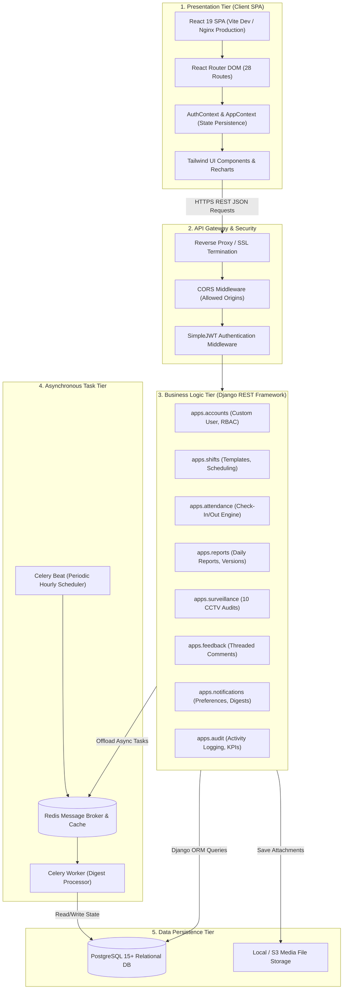
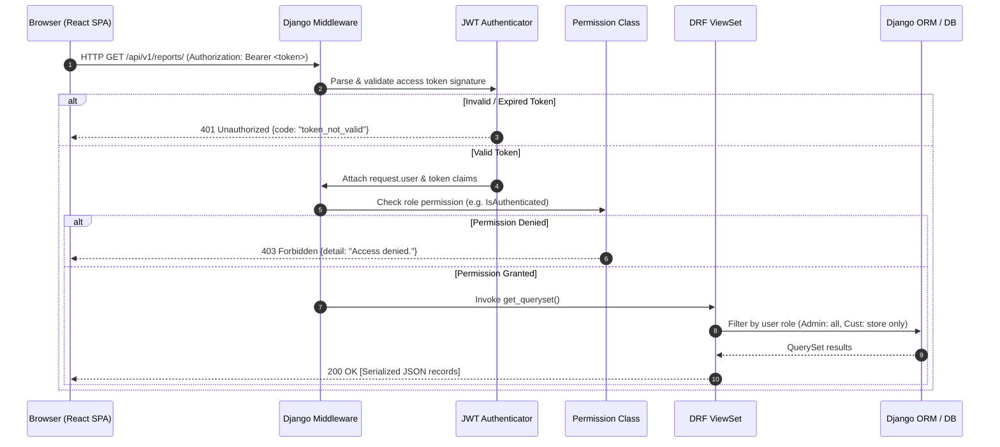

# 🏛️ System Architecture: WorkTrack

> **Document Status:** `ARCHITECTURE BASELINE`  
> **Architecture Pattern:** Multi-Tiered Decoupled Client-Server SPA & REST API Architecture

---

## 1. Architectural Overview

WorkTrack is engineered as a decoupled, multi-tier system separating presentation, business logic, asynchronous task processing, and persistent relational data storage. This design ensures that frontend UI state modifications never compromise core business invariants or database referential integrity.



---

## 2. Frontend Architecture (React.js SPA)

The frontend is structured around a component hierarchy powered by React 19 and Vite:

* **Entry Point (`main.jsx`):** Bootstraps the React virtual DOM and mounts `<App />` inside a high-level error boundary.
* **Routing Hierarchy (`App.jsx`):** Employs `react-router-dom` v7 to define 28 distinct view routes protected by role-based guards (`ProtectedRoute.jsx`).
* **Context State Management:**
  * `AuthContext.jsx`: Maintains active user session, token storage, and synchronous role switching between Admin, Employee, and Customer for evaluation.
  * `AppContext.jsx`: Manages reactive local state, notification queues, and optimistic UI updates.
* **Responsive Presentation Layer:** Built with utility-first Tailwind CSS, responsive grid layouts, and Lucide React icons.
* **Visualization:** Utilizes Recharts for dynamic attendance trends, shift distributions, and surveillance telemetry.

---

## 3. Backend Architecture (Django & DRF)

The backend follows Django's modular app philosophy, ensuring strict separation of concerns:

```text
backend/
├── manage.py
├── pytest.ini
├── requirements.txt
├── worktrack_project/
│   ├── settings.py         # Decoupled settings, SimpleJWT, CORS, Celery
│   ├── urls.py             # Root routing with drf-spectacular OpenAPI
│   ├── celery.py           # Celery instance configuration
│   └── wsgi.py
└── apps/
    ├── accounts/           # User model, SimpleJWT views, RBAC permissions
    ├── employees/          # Employee profiles, codes, HR records
    ├── customers/          # Customer profiles, company metadata, timezones
    ├── assignments/        # Employee-Customer contract allocations
    ├── shifts/             # Shift templates and daily roster scheduling
    ├── attendance/         # Check-in, check-out, UTC calculations
    ├── reports/            # Daily reports, version snapshots, attachments
    ├── feedback/           # Threaded customer comments and employee replies
    ├── surveillance/       # 10 CCTV camera feeds, AI telemetry, audits
    ├── notifications/      # Notifications, digest preferences, Celery tasks
    └── audit/              # Activity logs and role-specific dashboard KPIs
```

---

## 4. Database Architecture (PostgreSQL)

PostgreSQL was selected for its support of ACID transactions, foreign key constraints, JSONField indexing, and concurrency controls:

1. **UUID Primary Keys:** All major entities (`User`, `ShiftAssignment`, `Attendance`, `DailyReport`, `ReportVersion`) use UUIDv4 primary keys to prevent enumeration attacks.
2. **Referential Protection:** Core transactional records reference users and profiles with `on_delete=models.PROTECT` to safeguard auditability.
3. **JSON Snapshotting:** `ReportVersion.content_snapshot` utilizes PostgreSQL's binary JSON (`jsonb`) format for querying and storing immutable revision snapshots.
4. **Relational Constraints:** Enforced unique active constraints on `EmployeeCustomerAssignment` and unique version constraints on `ReportVersion`.

---

## 5. Authentication & Request-Response Lifecycle



---

## 6. Asynchronous Notification Architecture

```mermaid
flowchart TD
    Trigger[Operational Event: Report Submitted / Suspicious Camera] --> CheckType{Event Type}
    
    CheckType -->|Emergency Hotspot| Immediate[Immediate Push / Email Dispatch]
    CheckType -->|Standard Report| LogEvent[Persist Notification record with PENDING status]
    
    LogEvent --> Beat[Celery Beat Scheduler: Hourly Trigger]
    Beat --> Worker[Celery Worker: process_hourly_digest]
    Worker --> QueryPref[Lookup Customer NotificationPreference]
    
    QueryPref -->|Frequency = HOURLY| DispatchHourly[Send Consolidated Digest Email]
    QueryPref -->|Frequency = 6HOURS| Check6Hr{Current Hour in 06, 12, 18, 24?}
    QueryPref -->|Frequency = DAILY| CheckDayEnd{Current Hour = 23:00?}
    
    Check6Hr -->|Yes| Dispatch6Hr[Send 6-Hour Shift Digest]
    CheckDayEnd -->|Yes| DispatchDaily[Send Daily Closeout Report]
    
    DispatchHourly --> MarkSent[Update delivery_status = SENT, sent_at = NOW()]
    Dispatch6Hr --> MarkSent
    DispatchDaily --> MarkSent
    Immediate --> MarkSent
```

---

## 7. Technology Decisions & Rationale

| Architecture Decision | Chosen Technology | Alternatives Considered | Rationale & Trade-Offs |
| :--- | :--- | :--- | :--- |
| **API Framework** | Django REST Framework (DRF) | FastAPI, Node/Express | DRF provides built-in ORM integration, mature authentication, robust serialization, and seamless admin panels. |
| **Database** | PostgreSQL | MySQL, MongoDB | PostgreSQL offers native JSONB support for report snapshots and reliable ACID transactions. |
| **Auth Strategy** | SimpleJWT (Stateless JWT) | Session / Cookie Auth | Stateless JWTs decouple frontend deployment from backend API hosting, facilitating cross-origin API consumption. |
| **Async Task Queue** | Celery + Redis | Cron Jobs, Celery+RabbitMQ | Redis provides low-latency messaging and caching; Celery manages complex scheduled digests with minimal overhead. |
| **API Documentation** | `drf-spectacular` (OpenAPI 3) | drf-yasg, manual Postman | OpenAPI 3.0 standard with automated schema generation directly from DRF viewsets and serializers. |

