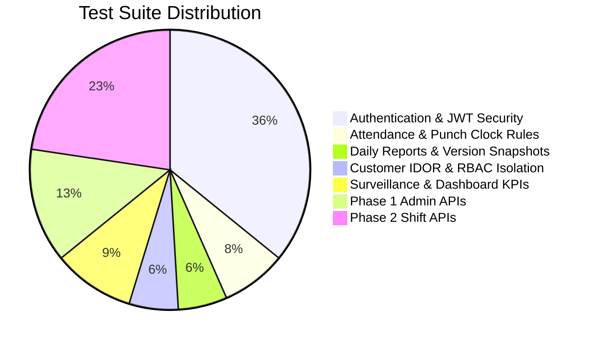

# 🧪 Automated Testing Strategy & Test Suite: WorkTrack

> **Testing Frameworks:** `pytest 8.3` | `pytest-django 4.14` | DRF `APIClient`  
> **Test Status:** Run `python -m pytest` for the current result; the suite includes Phase 1 and Phase 2 API tests.
> **Execution Location:** `backend/tests/`

---

## 1. Testing Philosophy & Quality Pyramid

WorkTrack's testing architecture emphasizes automated verification of high-risk business logic: authentication, sequential attendance enforcement, report version snapshotting, and multi-tenant data isolation.



---

## 2. Test Suite Structure

```text
backend/
├── pytest.ini                    # Configuration with DJANGO_SETTINGS_MODULE
└── tests/
    ├── __init__.py
    ├── test_auth.py              # Login, JWT issuance, /auth/me/, invalid password tests
    ├── test_attendance.py        # Punch-in, duplicate prevention, punch-out duration tests
    ├── test_reports.py           # Report creation, version snapshotting, submission tests
    ├── test_isolation.py         # Customer IDOR isolation, RBAC privilege boundaries
    ├── test_surveillance_and_dashboards.py # Simulated audits, admin KPIs, employee/customer home feeds
    ├── test_admin_phase1.py      # Admin CRUD, status changes, assignments, profile-list scoping
    └── test_shifts_phase2.py     # Shift CRUD, scheduling, overlap validation, and role scoping
```

---

## 3. Verified Automated Test Matrix

| Test Suite | Test Function Name | Tested Scenario & Assertion | Result |
| :--- | :--- | :--- | :---: |
| `test_auth.py` | `test_login_success` | Valid email & password returns 200 OK, JWT access & refresh tokens, user metadata. | **PASSED** |
| `test_auth.py` | `test_login_invalid_password` | Incorrect password returns HTTP 401 Unauthorized. | **PASSED** |
| `test_auth.py` | `test_current_user_me` | Authenticated request returns correct email and `EMPLOYEE` role. | **PASSED** |
| `test_auth.py` | `test_unauthenticated_me` | Request without token returns HTTP 401 Unauthorized. | **PASSED** |
| `test_attendance.py`| `test_check_in_success` | Assigned guard punches in; status is `PRESENT`; shift becomes `IN_PROGRESS`. | **PASSED** |
| `test_attendance.py`| `test_duplicate_check_in_prevented` | Second check-in attempt on same shift is rejected with HTTP 400 Bad Request. | **PASSED** |
| `test_attendance.py`| `test_checkout_without_checkin_fails`| Check-out attempt before check-in is rejected with HTTP 400 Bad Request. | **PASSED** |
| `test_attendance.py`| `test_check_out_success` | Valid check-out records timestamp, computes duration, marks shift `COMPLETED`. | **PASSED** |
| `test_isolation.py` | `test_customer2_cannot_access_customer1_reports` | **IDOR Shield:** Customer 2 queries Customer 1 report ID; returns HTTP 404. | **PASSED** |
| `test_isolation.py` | `test_customer1_can_access_their_own_report` | Customer 1 accesses their own store's report; returns HTTP 200 OK. | **PASSED** |
| `test_isolation.py` | `test_employee_cannot_create_customer_accounts` | Employee attempts to create customer account; returns HTTP 403 Forbidden. | **PASSED** |
| `test_reports.py` | `test_create_report_and_initial_version`| Creating daily report automatically creates initial `ReportVersion` #1 snapshot. | **PASSED** |
| `test_reports.py` | `test_update_report_increments_version_and_preserves_snapshot` | Modifying report increments version to 2 and preserves full JSON snapshot. | **PASSED** |
| `test_reports.py` | `test_submit_report` | Submitting draft transitions status to `SUBMITTED` with `submitted_at` set. | **PASSED** |
| `test_surveillance_and_dashboards.py` | `test_verify_camera_snapshot` | Guard verifies camera frame as `Flagged Suspicious`; persists audit notes. | **PASSED** |
| `test_surveillance_and_dashboards.py` | `test_submit_surveillance_batch` | Guard submits 1-hour package; batch marked `Submitted`, client alerted. | **PASSED** |
| `test_surveillance_and_dashboards.py` | `test_admin_dashboard_metrics`| Admin queries `/dashboard/admin/`; returns aggregated KPIs and weekly trends. | **PASSED** |
| `test_surveillance_and_dashboards.py` | `test_employee_dashboard` | Guard queries `/dashboard/employee/`; returns active shift & punch status. | **PASSED** |
| `test_surveillance_and_dashboards.py` | `test_customer_dashboard` | Client queries `/dashboard/customer/`; returns store coverage and reports. | **PASSED** |
| `test_admin_phase1.py` | Admin CRUD, deactivation, assignment lifecycle, profile scoping | Seven API tests verify password hashing, CRUD/status changes, disabled-account login rejection, assignment validation, and role-scoped lists. | **PASSED** |
| `test_shifts_phase2.py` | Shift CRUD, working days, overnight schedules, conflicts, and access isolation | Twelve API tests cover template validation/status/delete, schedule create/edit/cancel, overlap checks, and employee/customer permissions. | **PASSED** |

---

## 4. Test Execution Instructions

### Running the Complete Suite
```powershell
cd backend
.\.venv\Scripts\Activate.ps1
python -m pytest
```

The Phase 1 admin integration tests verify employee/customer creation and updates, password hashing, login deactivation/reactivation, assignment create/revoke/reactivate behavior, and employee/customer list scoping. Phase 2 tests cover shift template validation, recurring workdays, overnight intervals, schedule conflicts, cancellation, and role-scoped reads. The surveillance tests exercise simulated telemetry only; they do not validate real cameras or AI.

### Running Specific Suites with Verbosity
```powershell
# Run only IDOR isolation tests
python -m pytest tests/test_isolation.py -v

# Run only attendance tests
python -m pytest tests/test_attendance.py -v

# Run with test coverage report
python -m pytest --cov=apps tests/
```
